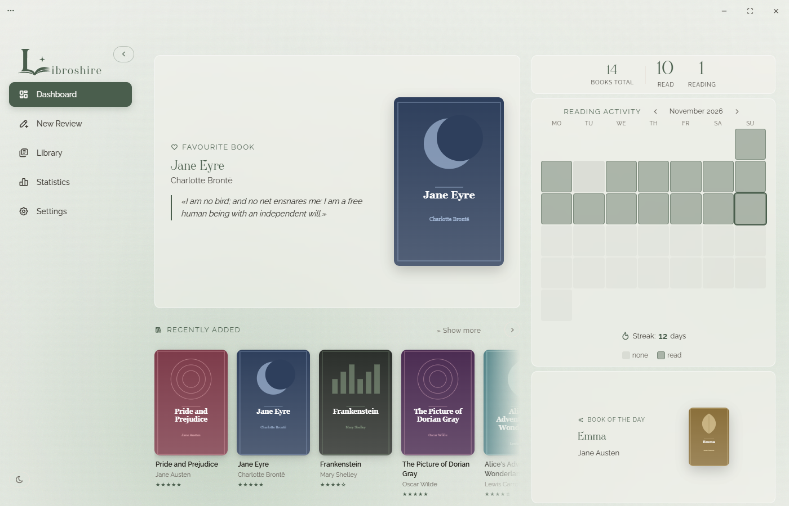
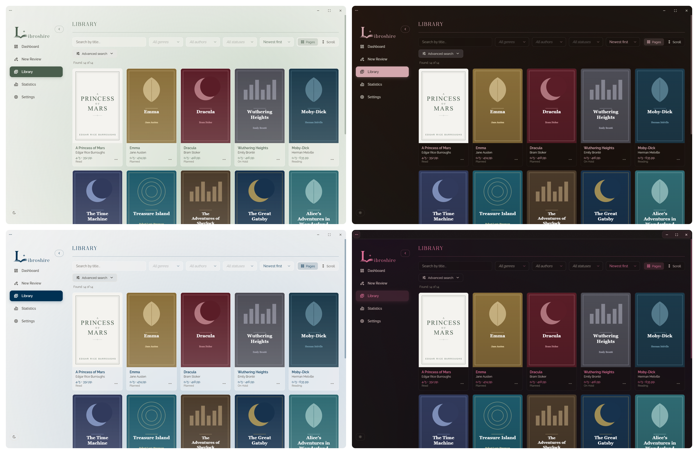
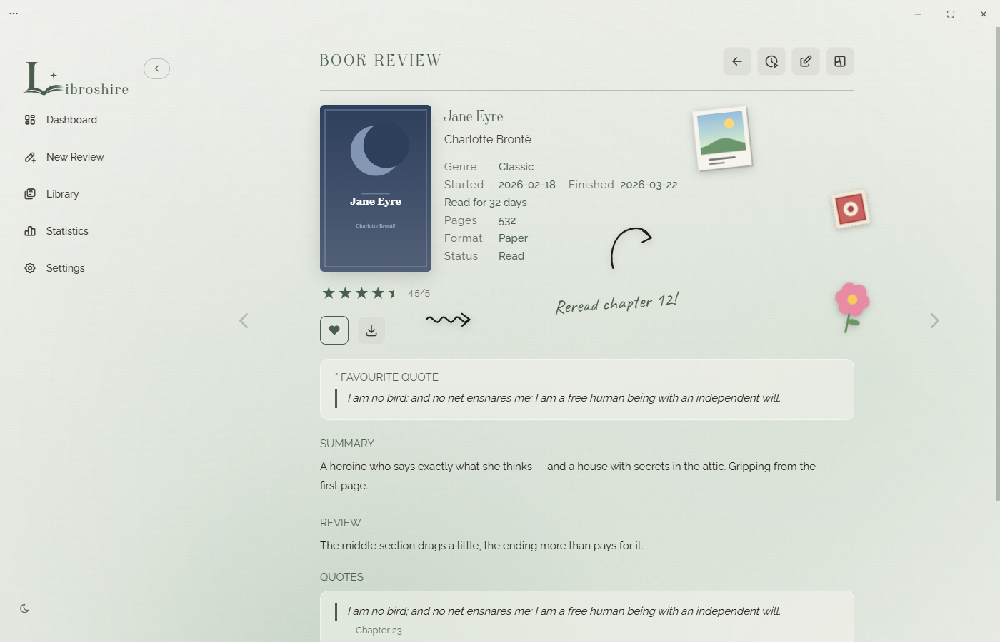
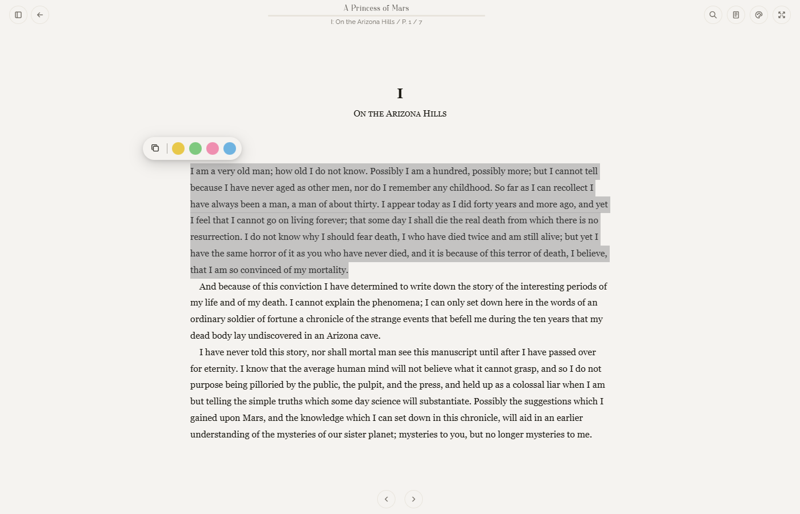
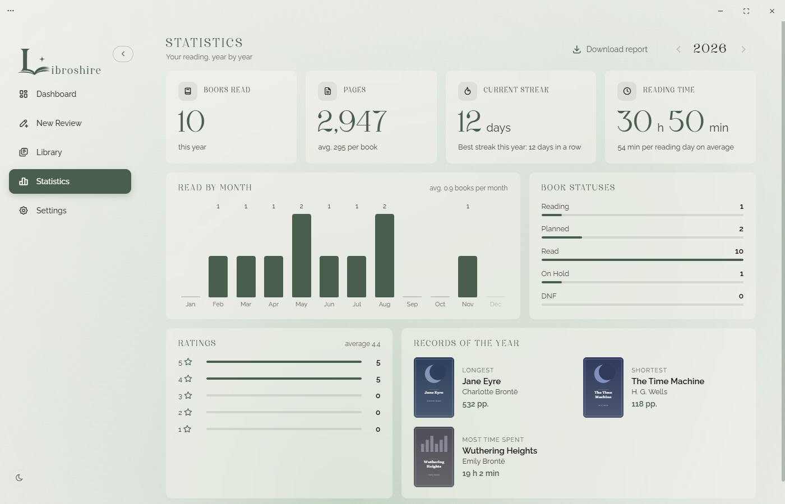
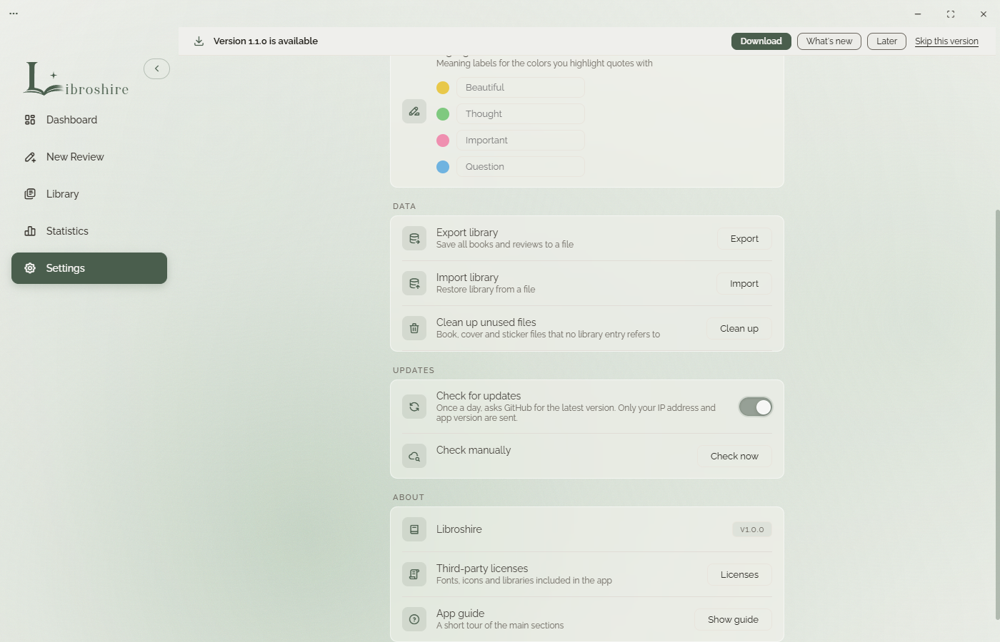

<h1 align="center">Libroshire</h1>

<i>A quiet place for your books, reviews and reading time.</i>

  
  
  

  

## What it is

Libroshire is a Windows desktop app that keeps your whole reading life in one place: library, reviews, quotes, statistics and a built-in reader. Everything is stored on your computer, with no accounts and no cloud.

## Features

- **Library**: statuses (Reading, Read, On hold, Planned), covers and search.
- **Reviews with a scrapbook**: rating, thoughts, favourite quotes, stickers and clippings on each book page.
- **Reader**: EPUB and PDF, table of contents, coloured highlights, copying quotes.
- **Reading timer** and yearly statistics: books, pages, streak, records.
- **4 themes × light/dark × regular/glass**, interface in English and Russian.
- **Export and import** of your library as a single file.

  

### Reviews and scrapbook

  

### Reader

  

### Statistics

  

## Installation

1. Open [**Releases**](../../releases) and download `Libroshire-Setup-1.0.0.exe`.
2. Run the installer and choose a folder (a `Libroshire` subfolder is created by default).
3. Done: the app appears in the Start menu.

> **Windows SmartScreen warning.** The app is not code-signed yet, so Windows may show "Windows protected your PC". Click **More info**, then **Run anyway**.

## Updates & privacy

Your library is stored only on your computer. Once a day the app checks GitHub for a new version (only your IP address and the installed version number are sent); you can turn this off in Settings. To update, download the latest installer from Releases and run it.

  

---

© 2026 Libroshire.

